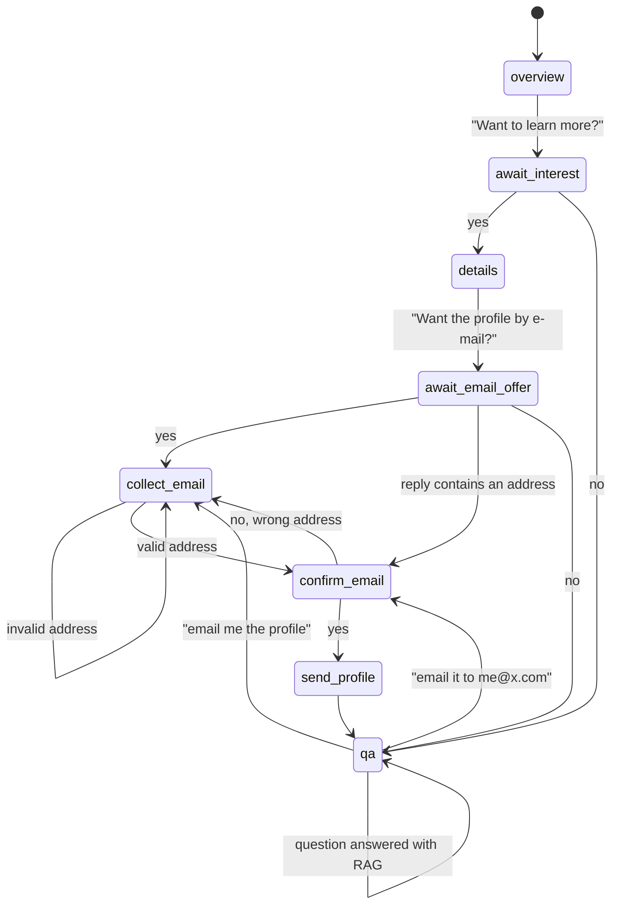

# Company RAG Chatbot: A Stateful Conversational Agent with LangGraph

[](https://github.com/shelenderrkumar/RAG-App/actions/workflows/ci.yml)


A chatbot that **leads a structured conversation** about a company instead of only
answering questions. It introduces the company, offers more detail, offers to e-mail the
company profile, collects and **confirms** the user's e-mail address, sends the PDF, and then
answers free-form questions with **retrieval-augmented generation (RAG)** and page citations.
Replies stream token by token over a WebSocket.

**Stack:** LangGraph (state machine and checkpointing), LangChain, OpenAI, FAISS, pypdf,
FastAPI WebSockets.

---

## The problem

Most RAG demos are stateless question answering. Real assistants have **goals and
procedures**: they must remember where they are in a flow, accept messy human replies
("sure, it's jane@x.com", "hmm, not right now"), recover from mistakes ("no, that's the wrong
address"), and still answer off-script questions. This project models the conversation as an
explicit, checkpointed **state machine with human-in-the-loop interrupts**. The LLM handles
language; the graph enforces the procedure.

## Conversation graph



Every node that waits for the user calls LangGraph's `interrupt()` as its first statement.
The run pauses, the server sends the assistant's message, and the next user message resumes
the graph with `Command(resume=text)`. State (messages, e-mail, flags) is checkpointed per
conversation `thread_id`, so each WebSocket connection is an isolated session.

## Design decisions

| Decision | Why |
|---|---|
| **Explicit graph instead of one big prompt** | The procedure (offer → collect → confirm → send) is guaranteed by code and unit-testable without an LLM. The model only writes text and classifies ambiguous replies. |
| **Hybrid intent parsing** | Clear replies ("yes", "no thanks") and e-mail addresses (regex) are parsed deterministically. Only ambiguous replies go to a structured-output LLM classifier, which saves a model call on most turns. |
| **Confirm before acting** | E-mail is an irreversible side effect, so the bot reads the address back and lets the user correct it. |
| **Page-aware chunking and citations** | PDFs are loaded page by page and split with overlap. Chunks keep their page number, and answers cite pages like `[p. 3]`, so users can verify claims. |
| **Query condensation** | Follow-ups such as "how much does it cost?" are rewritten into standalone search queries using the conversation history before retrieval. |
| **Internal LLM calls never reach the UI** | Classifier and rewrite calls are tagged `internal` and filtered out of the token stream. |
| **Streaming with stable ids** | Tokens and final messages share the same message id, so the UI finalises the streamed bubble in place instead of duplicating it. |
| **Pluggable e-mail delivery** | SMTP with the PDF attached when configured, otherwise a console sender for demos and tests. Failures are reported to the user instead of crashing the chat. |

## Quick start

```bash
git clone https://github.com/shelenderrkumar/RAG-App.git && cd RAG-App
python -m venv .venv && source .venv/bin/activate
pip install -e ".[dev]"
cp .env.example .env       # add OPENAI_API_KEY
python main.py             # open http://localhost:8000
```

To use your own company, drop PDFs or Markdown files into `data/`, set `COMPANY_NAME`, and
delete `data/index/` so the index is rebuilt. Docker:
`docker build -t rag-chatbot . && docker run --env-file .env -p 8000:8000 rag-chatbot`.

## Evaluation

`data/eval_questions.json` holds 12 questions, each labelled with the page and the text span
that answers it. `scripts/evaluate_retrieval.py` reports **hit rate@k** and **MRR** so that
chunking and retrieval settings can be compared empirically:

```bash
python scripts/evaluate_retrieval.py --chunk-size 800 --overlap 120 --k 4
python scripts/evaluate_retrieval.py --chunk-size 300 --overlap 50 --k 4
```

## Testing

```bash
pytest -q    # 22 tests, offline: fake chat model and deterministic fake embeddings
ruff check .
```

The tests drive complete conversations through the real graph:
- the happy path through to the e-mail and its attachment
- declining each offer
- invalid e-mail addresses and correcting a wrong one
- requesting the e-mail later from free-form Q&A
- isolation between two concurrent users
- graceful handling of SMTP failures
- that internal LLM calls are never streamed to the user
- a WebSocket session end to end

A data test checks that every evaluation answer really appears on its labelled page.

## Project layout

```
ragchat/
  graph.py           conversation state machine (LangGraph)
  session.py         runs one conversation: streaming, resume, turn boundaries
  server.py          FastAPI app and WebSocket protocol
  knowledge_base.py  PDF/Markdown loading, chunking, FAISS index, citation formatting
  intents.py         yes/no and e-mail parsing with LLM fallback
  email_sender.py    SMTP and console senders
  prompts.py, config.py
static/index.html    dependency-free chat UI (light and dark mode)
data/                company profile PDF (fictional company) and evaluation set
scripts/             build_index.py, evaluate_retrieval.py
tests/
```

## Limitations and future work

- Conversation state lives in memory. Swap `InMemorySaver` for a Postgres or SQLite
  checkpointer to survive restarts.
- Retrieval is dense-only. Next steps: hybrid BM25 + vector search and a cross-encoder
  re-ranker, measured with the evaluation script.
- Answer faithfulness is not yet evaluated automatically (e.g. LLM-as-judge or RAGAS-style
  groundedness against the cited chunks).
- No authentication or rate limiting on the WebSocket endpoint.

The demo company, *Lumora Analytics*, and its profile are fictional.

## License

[MIT](LICENSE)
